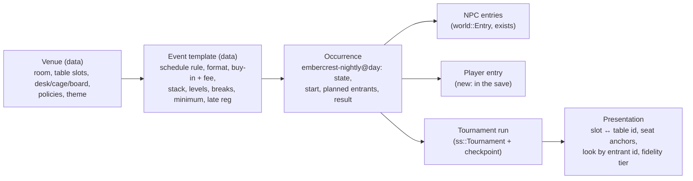

# SHORT STACK: Live Tournaments, the Foundation

Draft v1, 2026-10-03. Written against `desktop-work` at 4354ebc. Extends `GAME_DESIGN.md` §3, §6 and §7. It doesn't replace them.

Updated 2026-10-18 for update 2's first gate: autoplay at the live tables (§16), the skip's checkpoints (R5), the filming rule (R11) and a fresh world at the Embercrest (§17). Updated 2026-10-19 for its second gate: the live nights on Rerun, the video channel (R11). Updated 2026-10-20 for its third gate: the rival online sites stay online (R12).

**This update:** grow the Embercrest from "the Sunday tournament" into the city's **local casino card room**. It runs 2 to 3 tournaments every day, with fields of 60 to 120, in a room you can walk around.

## 1. The recommendation

Build the live world by making **the Embercrest** honest, busy and whole. Don't start with a bigger map.

The Embercrest Sunday $150 already runs on the real tournament engine, takes real money from the bankroll, feeds the living world, and sends the player home to a text from Dee and, after a win, a cup on the windowsill. It is missing six things. Every later venue needs the same six:

1. **A schedule.** The room runs every day, and the calendar, RiverLine and the room's own screens all show it.
2. **One field.** The living world decides who enters; the tournament seats exactly those people.
3. **One entry record.** Paying, refunding and settling happen once each, survive a crash, and show up as separate ledger lines.
4. **Breaks**, and a tournament clock the world clock agrees with.
5. **A room whose table numbers are real places.** You walk to the table you were assigned.
6. **Being in the venue without being seated.** You can arrive, register, take a break, bust, and leave on your own terms.

Do them in that order, at one venue. River City Classic, the Grand Circuit and the Championship then reuse the same contracts with new rooms and data.

## 2. What exists today

Evidence: code reading at 4354ebc, and all 7 core test suites passing at that commit (golden_vectors, engine_invariants, night_one_session, riverline_ui, monkey_play, living_world, synthesized_audio). The Embercrest's in-engine flow was last played on 2026-10-01 and was **not** replayed for this audit.

| System | Status | Evidence | What matters for live play |
|---|---|---|---|
| Tournament engine | **Working, tested** | `ss::Tournament` (`Tournament.h`), engine_invariants and night_one_session | Every table plays real hands with one engine. It has balancing and table breaking (`Balance`), hand-for-hand, bubble and final-table events, payouts, ICM, and late registration (`HeroAway`: the seat is held and not dealt). Walking away is `HeroSitsOut`: dealt in, check/fold until blinded off. Formats: bounties, mystery bounties, satellites. **It has no breaks, no live re-entry and no snapshot/restore.** One tick is one hand at every table. |
| The Embercrest Sunday $150 | **Partial, works end to end** | `Game/Live.h/.cpp`, `BackRoomLive.cpp`, session_test `Embercrest()` | One event a week, 42 to 60 entrants, 6-max. The route: Burner → `Session::GoToGame("embercrest")` → the BackRoom map as a card room (`?Live=embercrest`) → settle → home. See §3 for its problems. |
| Living world | **Working, tested** | `Game/World.h`, `WorldSim.cpp`, `WorldHero.cpp`, living_world | NPC careers at three fidelity tiers ("the cards are never touched"). `LiveCalendar` runs from local weeklies to the Summit. Registrations (`Pending`, `Entry`), bonds and memories, `Greeting`, and `EmbercrestDone`. For online events it has `HeroEntered`/`HeroFinished`. |
| Card room | **Partial** | `BackRoomStageCardRoom.cpp`, `PlaceExtras`, `SetRoomTurn` | A 28.5 × 21 m room with the player's table plus 8 others. The player's table is fixed at the origin and the room *turns* when you're moved. Other tables get three MetaHuman extras each and close when the engine's tables close. It has clock screens, the floor on the PA, and a synthesized crowd (`FCardRoomAmbience`) that thins with the room. **Its frame rate has never been measured.** |
| Being in the venue | **Absent** | `PlayWalk` (scripted paths) is the only movement | No walking, no interactions, and no input states beyond seated and menu. |
| Discovery | **Partial** | `life::Catalog` ("embercrest"); `LiveCalendar` is used only by the sim | The only place the player learns about the Embercrest is Dee's Burner thread. |
| Money | **Working online, thin live** | `life::State::Ledger`, `Tickets`; `LoadLive` | The live buy-in is hard-coded twice (`EmbercrestBuyInCents`, and `15000` in `life::Blocked`). The Embercrest deducts it when the map loads and writes one *net* ledger line at the end. No travel cost. |
| Time | **Working, implicit** | `ClockMinutes`, `Session::ResumeCalendarFrom`, `World::AdvanceTo` | The Back Room keeps its own `Minutes` and writes them back. The world catches up at home. An online tournament blocks leaving. |
| Save | **Working** | `CareerSave` (.ssave, background, legacy .sav migration), `SaveData::WorldNotes` | No record of a live entry and no tournament checkpoint. |
| Home continuity | **Working** | `HomeTextFromOptions`, `Room.bTrophy = LiveBestPlace == 1`, `Life.Reads` | Dee's text matches the result. The Embercrest cup appears after a win. Reads learned persist. |
| Streaming at a venue | **Absent** | Kast is home-only; `GoToGame` ends the stream | The feature table's ON AIR light is decoration. |

## 3. Rulings

Directives for every venue.

**R1. One field.** The world plans an occurrence's entrants (`World::Registered(<occurrence id>)` plus an anonymous count). The host builds the `Tournament` from that list and nothing else. Today the field comes from two places. `EmbercrestSpec` invents its own size, and `EmbercrestReserved` seats all eight of the cast every week. The world separately plans who comes, and `EmbercrestDone` reconciles the two afterwards.

**R2. People come because they can.** `Regular()` in `WorldSim.cpp` forces the cast into every Embercrest, regardless of bankroll (Mrs. Park at 75%). Replace it with a strong home-room preference that still respects budget, form, schedule and status. Some weeks Rick is broke and doesn't show. Mei is at River City for the Classic.

**R3. Seating is a draw; moves come only from balancing.** Retire `Tournament::FeatureIds`. It swaps the cast onto the player's table seat-for-seat after every balance, which is the "secretly arranged" story this brief rules out. An honest draw puts familiar faces together anyway, most of all as the field narrows. If the room streams a feature table, that's a published policy applied **at the draw**, and the player isn't guaranteed to be at it.

**R4. One entry per player per occurrence.** The player's entry is a record in the save: entry id, occurrence id, what paid (cash or ticket), fee, state, place, prize and a settled flag. Money moves only in `Register`, `Refund` and `Settle`, each idempotent by entry id. Separate ledger lines: entry, fee, travel, prize.

**R5. Safe-save boundaries are explicit.** The game saves at registration, **after every completed hand**, at every break and at settlement. A checkpoint holds the tournament state (players, stacks, tables, tick, level, RNG state). If the game is quit mid-hand, a confirmation says "This hand will be folded." If it crashes mid-hand, the next load resumes at the start of that hand with the same deal. A registration is never lost; a buy-in is never charged twice. While autoplay skips ahead (§16), the game saves every 5 hands and where the skip stops, and the checkpoint carries the plan too (its style, tilt, Sharpness and counts), so a crash mid-skip comes back at most four hands earlier, with the same deals and the same plan, waiting for the player's K.

**R6. Minimum field, stated.** Each event names its minimum (the Embercrest's: 18 entrants, three tables). Below it the event is cancelled and every entry refunded in full; the screens say so. No invented entrants or prize money. Anonymous entrants are part of the world's planned count (their skill is in `Pending::Strength`), generated deterministically from the occurrence id. They are not padding for an unresolved rule.

**R7. Memory is what people saw.** Bonds change on observable events only: sat together, knocked out, a pot shown down, a final table, a title. Nobody remembers hole cards that weren't shown. Bonds never touch decisions about cards or chips. No soft-play or chip-dumping.

**R8. The tournament waits for walks the game starts.** A table move, the walk to your seat after a break, or "take me to my seat" never costs a hand. The engine's tick is the clock, so the tournament doesn't deal until you're seated. Only a choice the player makes with a published consequence (walking away, ignoring the break's end) can cost chips.

**R9. Presentation can't change results.** Chips, cards, eliminations and payouts come from the engine. An actor that fails to reach a chair is blinked into it. A skipped celebration settles exactly the same.

**R10. Table size.** The Embercrest is a **6-max room**: its tables, seat anchors and table animation are built for six and a dealer. 60 to 120 entrants is 10 to 20 tables. A 9-handed room would need a new table rig and is a separate decision.

**R11. No filming at the tables.** The Embercrest, like real card rooms, doesn't allow cameras at its tables, and no venue streams: Kast stays at home, and leaving for a venue ends a stream. A live night reaches the player's video channel (Rerun, built at update 2's gate 2; `GAME_DESIGN.md` §5) told vlog-style: the hands replayed as cards, the player's portrait instead of a facecam (on a Reaction thumbnail a portrait draws a few fewer clicks than a facecam), and only what the player saw. Hands the plan played through a skip are kept as well, with an AUTO chip that only the player sees, and a night's Recap can mix them with hands that were watched. Dee's game is storytime only: no names (the others are "Seat 1", "Seat 2"), no faces but the player's, "a back-room game"; the first time one goes up, Dee texts "Saw the video. No names. Good."

**R12. The rival sites stay online.** Ignite Poker and RunItTwice (built at update 2's gate 3; `GAME_DESIGN.md` §5) are online sites. No venue hosts their events, and no rival hosts a bracelet or ring: the Championship Online and Ring Rush are RiverLine's partnerships with the live tours. A live buy-in, like the rent, comes only from the bank; money on a site, or on its way back from one, never pays at the desk. A site deal's "plays only on" clause covers online tables, streams and the videos of online hands, so a night at the Embercrest, and its video, is never a strike under Team RiverLine or Team RunItTwice. Team RunItTwice is the site deal that wants you in the room: four live events every 30 days in its patch, and a bonus for every live final table made wearing it.

## 4. The Embercrest Casino card room

**The place.** A mountain resort casino on the ridge above the city, home of the **Embercrest Poker Series**. From outside (`/Game/Maps/Embercrest`): the 14 stops at the foot of the drive; the plaza steps up between cascades and fire bowls to a lit larch canopy, the casino's wings, the LED marquee with tonight's event and the hotel tower with its three-peaked crown, under the massif the mark is drawn from, with the city's lights in the valley 900 m below. The brand is a three-peaked crest with the ember rising behind it, in midnight navy, ash white and ember copper (art/blender/brand.py makes the mark and every screen, sign and banner). The poker room is off the main floor. Inside:

- **Walls and ceiling:** navy fabric acoustic panels split by copper reveals, an ember LED cove line round the room, smoked oak slats above; black coffers with lit trays; black glass columns with an ember line down each corner. Printed banners (PLAY / COMPETE / RISE) hang down the walls.
- **Tables:** navy speed cloth with the Embercrest's mark and a copper betting line, black leather rails, a linear pendant over each, the table number on a hanging LED sign.
- **Floor:** navy carpet with bronze four-lobed stars in steel-blue scallops.
- **Front of the room:** the tournament desk (two windows), a whiteboard cash waitlist, and the **winners' wall**, a board with the last 14 days' champions.
- **The cage:** behind a copper grille.
- **The stage:** the final table's stage at the far end, ember-edged, with LED pylons and a truss, in front of the backdrop screen (the lockup over the ranges). Two big tournament clocks flank it; two more are on the side walls.
- **Doorway:** slot-machine chimes coming through from the main floor.
- **The rail:** a bar along the right wall where railbirds stand.
- **The break area:** the **terrace** through the glass doors: stone, a rail, two lanterns, the ranges white under the stars and the resort's lights on the slopes.
- **Staff:** Dee deals weekends at the stream table. A floor manager walks the aisles with a clipboard and a radio. A chip runner pushes a racked cart.

**The schedule.** Every day; 2 events Monday to Thursday and Sunday, 3 on Friday and Saturday. Freezeouts, 6-max, a big-blind ante from level 3.

| Day | 12:00 PM | 7:00 PM | 10:30 PM |
|---|---|---|---|
| Mon to Thu | **Noon Deepstack** $80 ($70 + $10), 15,000 chips, 20-minute levels, about 60 to 80 runners | **Embercrest Nightly** $120 ($105 + $15), 20,000 chips, 20-minute levels, about 70 to 100 | |
| Friday | Noon Deepstack | Embercrest Nightly | **Midnight Turbo** $60 ($52 + $8), 10,000 chips, 10-minute levels, about 60 to 75 |
| Saturday | **Saturday Big Stack** $200 ($180 + $20) at 1:00 PM, 30,000 chips, 25-minute levels, about 90 to 120 | Embercrest Nightly | Midnight Turbo |
| Sunday | **Sunday Warm-Up** $80 | **Embercrest Sunday** $150 ($135 + $15), 20,000 chips, 20-minute levels, about 90 to 120 | |

- Late registration runs 3 levels; at the Turbo, 4.
- Breaks: 15 minutes every 6 levels; 10 minutes every 6 levels at the Turbo.
- Payouts are the engine's table, about 15% of the field paid.
- Fields come from the world's planning, so they move with the day of the week, the weather of the local scene (who's broke, who's on a heater, who's at River City), and a slow growth as the room gets a name.
- The world's own calendar holds the same events, so the regulars' careers are made here too.
- `embercrest@<day>` stays the Sunday's id, so old saves and memories keep pointing at the right event.

**The room grows to fit.** It becomes roughly 36 × 30 m:
- 20 tournament tables in five rows, numbered on brass plaques.
- The stream table, under its own truss lights, roped off.
- 4 cash tables along the rail side, under the waitlist board ("1/2 NL: 3 tables, list 6").

The field is visible in the room. Tables that aren't needed are covered and dark. When a tournament table breaks, a dealer racks it and the floor calls it. Late in the night, broken tables reopen as cash games and the waitlist grows. At the final table, the whole room's light pulls in to one table.

**Fidelity.** A full-resolution MetaHuman is the costliest thing in the game (Dee's game, 5 of them: GPU 14.1 ms, hair 2.3 ms; see §12). The room keeps three tiers, by distance from the player:
- **Near:** the player's table and its neighbors get full characters and table animation.
- **Room:** other running tables get people at reduced LOD, without strand hair or shadows, on shared idle and action loops, with chips and cards moving on the engine's real hands, at a lower update rate.
- **Far:** beyond the room's middle, silhouettes with lights, sound and motion.

The engine always plays every table; only the picture thins out.

## 5. The night, step by step

| Step | What the player does | Built on | This update |
|---|---|---|---|
| Discover | The wall calendar shows today's and tomorrow's Embercrest events. RiverLine gets a **Live** tab. Dee and regulars text about the weekend. | `LiveCalendar`, phone, Burner | Calendar and Live tab |
| Prepare | The event card: start, buy-in + fee, stack in big blinds, level length, breaks, late-reg close, minimum field, about how long a deep run takes, the bus fare. "Rent is due in 4 days." | `life::Blocked`, Bank | Event card with warnings |
| Travel | The 14 bus, 20 minutes, $2.90 each way. | `LoadLive`'s clock | Fare line and clock |
| Arrive | The doors from the casino floor: the desk, the screens, the room by number. | Card room | Walk mode |
| Register | At the desk, once. Repeat visits take one confirm. | R4 | Core `Register`; the desk |
| Find the seat | "Table 12, seat 4" on your ticket and the screens. Plaques, a floor arrow on request, "Take me to my seat". | Table slots | Real table slots |
| Play | The existing seated table. | `ABackRoomTable` | Unchanged |
| Breaks and moves | Breaks open the room: the deck, the vending machine, who's standing with whom. A move is a walk to a real table. | Engine breaks, `LiveMove` | Both |
| Finish | Bust: a dealer's line and you're standing in the aisle. Rail, play the next event if registration's still open, or go home. Cash: the cage. Win: your name on the wall. | `LiveOver`, `LiveSettle` | Settlement in core; staying in the room |
| Aftermath | Home: bank lines, Dee's text, the cup after a win, a message from someone you sat with, tomorrow's events on the calendar. | `HomeTextFromOptions`, `Room.bTrophy`, `Greeting` | Messages from bonds |

## 6. The venue ladder

The world calendar already has every rung, and the player's ladder is the calendar the NPCs live on.

| Stage | Venue | In the calendar | Identity |
|---|---|---|---|
| Neighborhood | **Dee's game**, the Wash & Fold's back room | `dees@<day>` | Exists. One table under a hanging lamp, dryers through the wall. |
| Local | **The Embercrest Casino card room** | Sundays today; daily with this update | §4 |
| Established regular | A second room (later) | No | Deliberately different: a bright modern card club with glass and LED clocks, weekday turbos, younger online grinders playing live. |
| Traveling competitor | **River City Classic** | Monthly: $350 Deepstack, $330 satellite, $550 Main, $1,100 High Roller | A convention hotel ballroom: pipe-and-drape, three registration windows, luggage under chairs, a hotel bar that never empties. The first trip and the first hotel bill. |
| Major-event contender | **Grand Circuit** stops; the summer **Championship** | Ring events; bracelet events and the $10,000 Main | Rows to the horizon, zoned events, a feature stage with broadcast light. The floor empties as the days go. |
| Elite | **The Summit**, Monte Carlo | Invitation-only $1,000,000 | A private salon. Six tables, then one. Reputation and invitation, never bankroll alone. |

Public events stay open to anyone who can pay. Reputation gates only invitations, introductions and media. Satellites are a second road in. Tickets stay tickets (`life::State::Tickets`).

## 7. Data and responsibilities

| Owner | Owns | Never does |
|---|---|---|
| `ss::Tournament` (core) | Cards, actions, pots, stacks, levels, **breaks**, balancing, eliminations, places, payouts | Know about actors or money |
| `ss::world::World` (core) | Who enters an occurrence, NPC money and memories, history | Seat people or change results |
| `ss::Session` / `life::State` (core) | The player's money, ledger, tickets, clock and **entries** | Render anything |
| UE host (`ABackRoomGameMode`, stage, table) | Shows the night and asks for actions | Decide anything |

The flow is always: the world asks → the owner validates → the owner commits and saves → the presentation shows the result.

**Reuse:** the tournament engine, `world::Pending`/`Entry`, `LiveCalendar`, bonds and memories, `ABackRoomTable`, the card room stage, `FCardRoomAmbience`, the PA floor, the clock screens, `CareerSave`, Dee's texts and the windowsill cup.

**New (proposed names):**
- `live::Venue` and `live::EventTemplate` as data. The schedule and prices live in one place.
- `life::LiveEntry` in the save.
- Breaks in `TournamentSpec`.
- `Tournament::Write`/`Read` for checkpoints. This needs `Rng` state get/set, because sfc32's state words are private today.
- An `ss.Live.Describe` debug command.

## 8. Time

- **One clock:** world minutes. While the player has an active entry and is in the venue, the world clock **is** the tournament clock (start + hands × seconds per hand + breaks).
- **Pause freezes both.** Pausing isn't sitting out, and the pause menu says so.
- **Breaks:** a countdown on the screens and "Return to seat", which always works. At the end, the tournament resumes. If you're still on the deck by choice, you're dealt in and your blinds are posted (the published away rule).
- **No overlap:** one active entry at a time, live or online. Busting the Noon Deepstack early leaves the Nightly open, and that's a real choice.
- **Unattended:** the world never pre-resolves an occurrence the player is in.

## 9. Money

- **Register** writes entry and fee as two ledger lines and saves. **Settle** writes the prize. **Travel** writes the fare. **Refund** reverses entry and fee for a cancellation.
- Each operation is keyed by entry id. Repeating it, or reloading after it, does nothing.
- Rent stays the pressure. Shifts and Dee's game stay the way back. A bad Nightly costs $125.80 and an evening, never the career.
- Success shows up in the life sim, not the deck: the cup, the winners' wall, the bank, a reason to drop a shift.

## 10. The circuit's people

- The field is the world's people (R1). Faces are stable: a look is a hash of the entrant's id. Today a stranger gets one of 4 bodies in order of arrival (`ExtraBodies[AnonymousLooks++ % 4]`).
- The cashier and the floor learn your name after a few visits.
- On breaks, people with a bond stand together on the deck. `Bond::Label` and memories pick a line.
- Off-screen, the world keeps entering and missing events. "I played against that person at the Embercrest; now we're both in the River City Main" follows from shared calendars, without any script.

## 11. Drama without a script

The floor already announces levels, busts near the money, hand-for-hand, the bubble and the final table. Add last call for registration, "Table 7 is breaking, players to the new seats on your tickets," and the room's light pulling in as tables close. Scale reactions to the event: a Sunday win is Dee's voice on the PA (she's in the box on Sundays; the caption reads DEE · PA) and your name on the wall, not confetti. Tells stay noisy. A presentation setting (Cinematic / Standard / Fast) comes later, and Fast loses nothing that matters.

## 12. Budgets (measured and target)

Measured this week on an RTX 4070 SUPER, in PIE at 2552×1222:
- **Dee's game:** 5 MetaHumans. 65 fps, with dynamic resolution holding 60 at 66% scale. GPU 14.1 ms (hair 2.3, virtual shadow maps about 3.8, TSR 1.3); game thread 10.8 ms.
- **Night One's window:** 85.6 fps, GPU 10.95 ms at 100%.
- **Background save:** about 4 ms on the game thread.
- **The current card room:** **not measured**. Measure before building on it.

Targets for this update (to verify, not promises):
- 60 fps with dynamic resolution at 75% or higher, in a full room (20 tables running).
- 6 near-tier people (the player's table and the dealer) plus at most 12 more at neighbor tables.
- Room tier capped by count.
- Loading under 10 s.
- No hitch on a per-hand save.

## 13. Scope

| This update | The same foundation, later | Out of scope now |
|---|---|---|
| The Embercrest's daily schedule (§4), fields of 60 to 120, 6-max freezeouts | Bounty, re-entry and satellite events at the Embercrest | Real-money or networked play |
| One field (R1), honest attendance (R2), draw and balancing (R3) | A second local room | A drivable city |
| Player entry, idempotent money, separate ledger lines (R4) | River City Classic: travel, hotel, multi-event plans | |
| Per-hand checkpoints, crash resume (R5), minimum field (R6) | Multi-day events: bags, redraws, overnight counts | Full broadcast production |
| Breaks in the engine and the room | Feature-table seating rules, venue streaming | Crowd simulation beyond the tiers |
| The bigger room: 20 numbered tables, stream table, cash tables, desk, cage, winners' wall, terrace; walk mode | Bond-driven conversations; staff recognition | |
| Staying after a bust; going home | Grand Circuit, Championship, Summit | |
| Calendar and RiverLine **Live** tab | | |
| `ss.Live.Describe` debug | | |
| Since then (next_segment_spec): backing (stakes, pieces, swaps, packages, coaches who back you) and sponsors (contracts, negotiation, patches, Team Embercrest) | The player backing others | |
| Since then (update 2, gate 1): autoplay at every Embercrest event and at Dee's game from night 2, with the budgeted live skip (§16); the filming rule (R11); a fresh world's empty board and its talk (§17) | A skip at Dee's; a live skip that hands over a premium hand mid-hand; the plan's auto-peek | |
| Since then (update 2, gate 2): the Embercrest's hands and nights on Rerun, told vlog-style, and Dee's game as storytime (R11) | | |
| Since then (update 2, gate 3): the rival online sites, kept online: bank-only live buy-ins, no clause strike for live play, Team RunItTwice's patch at live events (R12) | | A rival site's live event, series stop or venue |

## 14. A Saturday at the Embercrest

Saturday, 12:10 PM. Rent's paid, $640 in the bank. The calendar has three blue cards: the Big Stack at 1, the Nightly at 7, the Turbo at 10:30. The Big Stack is $200, a third of your roll. Dee texted Thursday: "big stack's a reach. nightly's your game." You take the 14 bus ($2.90) at 6:15 for the Nightly instead.

6:40 PM. The Big Stack is still running: 31 left of 112, four tables lit in the back row, a railbird at Table 18 holding up his phone until the floor waves it down (R11). The winners' wall says *THU NIGHTLY: SAL M. — $1,960*. At the desk: $105 + $15. "Table 12, seat 4." Table 12 is under the old proscenium. Sal's at Table 11, back to back with you, and nods. The other five at yours you've never seen. One is wearing a River City Classic lanyard.

8:00 PM. Last call for registration: 94 runners. 9:05 PM, the first break. On the terrace, Rick, who knocked you out at Dee's on Tuesday, says "You again." Mrs. Park didn't come tonight. Her player card says she played the Noon Deepstack and min-cashed.

**If you bust.** Level 11, 29 left, A♠Q♠ into Big Lou's kings. "Nice playing, seat 4." You're standing in the aisle with your jacket. The Turbo's late registration is open for another 50 minutes. The cash list for 1/2 is six names long. The 11:15 bus is the last one. You go home. The bank shows −$105, −$15, −$5.80. Dee texts "29th of 94. turbo's a lottery, good call going home." Big Lou's player card now reads "Knows you".

**If you win.** 2:40 AM. The floor calls the final table to the stream table. The room's pendants go dark one row at a time until only the truss lights are left. Heads-up against Mei, whose name was on the wall two weeks ago. Your queens hold. The cage counts out $2,215, and the cashier says "Congratulations, grinder." She finally has a name for you. Sunday, the wall says *SAT NIGHTLY: YOU — $2,215*. At home, the cup is on the windowsill. Mei's bond says "Rival". Her message: "rematch at river city?" The Classic is in 9 days, and it costs a bus, a hotel and a $550 decision.

## 15. Milestones for this update

**Status, 2026-10-05.**

- **M1 is built** (254923e). Covered by session_test and world_test, and played in the editor: registered from the Burner app, a Noon Deepstack and Nightlies, one to 11th of 97 and a cash.
- **M2 is built** (ad45abb):
  - The room is the cardroom kit and the crowd kit, plus MegaLights in this room only.
  - Measured about 63 fps, GPU 14.6 ms, with dynamic resolution holding 60 in PIE at 2552×1222 on an RTX 4070 SUPER.
  - Played: the walk in, a table move, a bust and the walk out, and a final table on the stage.
  - Not yet built from M2: walk mode and walkable breaks (breaks are timed holds), and cash tables.
- **M3 is mostly built** (10b3fc9, and the commit after it), with the walk mode M2 owed:
  - **Checkpoints (R5).** `Tournament::Checkpoint`/`Restore` save the whole tournament state after every hand. The card room writes the save on a worker thread and marks it again when the next hand is dealt.
    - A game closed mid-night goes back to the seat on the next launch (`Session::LiveInProgress`/`ResumeLive`). There's no bus fare, and nothing is dealt while the game is closed.
    - A hand already dealt when the game closed is dead (checked through or mucked), so no deck is seen twice.
    - A night the player never returns to is blinded off from its checkpoint.
    - Tested: session_test reopens a Sunday after any hand, and every forty hands; it plays on event for event and chip for chip. In the editor, the editor process was killed mid-hand and resumed into the same seat.
  - **Pacing.** A Table pace setting (Live / Brisk / Fast; also T at the table, where P, Esc and gamepad Start pause) scales the others' thinking and the folded speed-up. N plays out a folded hand quickly. Neither ever decides anything for the player; autoplay (§16) is separate, and acts only when the player turns it on.
  - **Recurring faces.**
    - The room has 39 regulars of its own in the living world (`live::RoomLocals`, `world::Origin::Local`), added to older saves on load. 64 regulars in all (`World::EmbercrestRegulars`), each with their own nights (`live::RegularHabit`). world_test measures about 8 at a Nightly, and most come back three or more times a month.
    - The entry records the faces in its field: who they are to the player, and what they say on sitting down (`life::LiveFace`, from the world's bonds).
    - The dealer greets regulars by name, studying a face shows its name and label, and weekday dealers have their own names and faces (Dee deals the Sunday).
  - **On foot.**
    - Q gets up from the table. The player stays dealt in: the dealer checks the hand when it's free and mucks it otherwise.
    - WASD and the mouse walk the room, with collision against tables, columns, counters, the rope, the bar, the stage and the walls. E reaches the chair, the desk, the cashier, the bar, the terrace and the door.
    - The desk and the cage recognize a first-timer, a regular and a past cash. Breaks can be walked.
    - After a bust, the summary waits: Q stays to rail while the room plays on (PA, boards, champion) and L goes home. The door ends the night.
    - What the player watched from the rail goes to the world (`SaveData::NoteLivePlaces`, `World::KnownPlaces`), and the world's result agrees: session_test checks a railed final. Embercrest results are kept, which also fills the champions' board.
  - **Closed on 2026-10-05** (73101dc, 1fe138e; played in the editor):
    - The railed table plays on: after a bust the old table follows the engine's table each simulated round (stacks, moves, busts leaving the chair, a broken table emptying).
    - Faces follow their person: twelve extras (ExtraA-L), each entrant's body picked once per night from their id with the far crowd's hash, pooled by body at the near tables and kept in the checkpoint.
    - The next event from the desk: after a bust the desk offers the next event still open today, registers it through the Burner's path, the PA calls it and the room reopens for it with no second fare or ride. Leaving while registered refunds it.
    - Last call on the PA and the screens before late registration closes; showdown pots become 'B' memories; people you sat with text you over the next day or two; a field below the minimum is recorded by the world as a cancellation.
    - The schedule outside the Burner: RiverLine's Embercrest tab with honest event cards (fee split, stack, breaks, late reg, minimum, a deep run's length, the bus, who's playing, rent warnings), the second screen's tile and a wall calendar.
    - Pause at the table stops both clocks and says so; quitting mid-hand asks first ("This hand will be folded"); full gamepad play.
    - The way in and out: the 14 stops at the resort's exterior (`/Game/Maps/Embercrest`), you walk up the drive and through the doors; after the night you come out under the canopy and take the waiting bus home.
  - **Still open:**
    - Cash tables.
    - The far crowd's baked figures can't wear a person's clothes, and `backroom_crowd.py` still finds sitters by the old persona names.
    - The player's table's pendant stays lit after that table breaks.
    - The hero at the table and the hero outside are built from different MetaHumans (hair and face differ).

**M1, the schedule and the honest field (core, standalone-tested, no new art)**
1. `live::Venue` and `live::EventTemplate` data: the Embercrest and its weekly schedule.
2. `LiveCalendar` holds the schedule.
3. The world plans the fields; `Regular()`'s forced attendance becomes a preference.
4. The field comes from `World::Registered` plus deterministic anonymous entrants. Retire `FeatureIds`.
5. `life::LiveEntry` with `Register`/`Refund`/`Settle`, the ledger lines and the bus fare.
6. Breaks in `TournamentSpec`.
7. The minimum-field cancel.
8. The host opens any occurrence (`?Live=<occurrence id>`).

| Area | Evidence (automated) |
|---|---|
| Schedule | For 8 weeks: 2 events Mon to Thu and Sun, 3 Fri and Sat, at the published times. Every occurrence id is unique, and `embercrest@<day>` is the Sunday flagship. |
| Fields | Planned fields fall within 60 to 120 over 8 simulated weeks, and vary by day. No NPC holds entries in two overlapping occurrences. Over 52 Sundays, a broke cast member misses at least one. |
| Registration | `Register` twice: one entry, one entry line and one fee line, bankroll down exactly once. Reload after registering: the same single entry. |
| Seating | Every `Moved` event in full 60- and 120-entrant runs comes from `Balance`. |
| Breaks | Each break falls on its level boundary; no hands are dealt during it; both clocks agree. |
| Settlement | `Settle` twice, or reload after settling: one prize line. |
| Minimum field | Below the minimum: cancelled, full refund, ledger reversal, and the world records a cancellation, not a winner. |
| Integrity | Engine invariants (chip conservation, legal actions) hold across 200 seeded 6-max runs of 60 to 120. |
| Regression | All 7 suites pass. Today's `.ssave` and a legacy `.sav` load. |

**M2, the room** (Blender and Unreal)
- The bigger card room per §4 and its fidelity tiers.
- Real table slots, with no turning room.
- Walk mode: desk, cage, screens, winners' wall, terrace.
- Breaks you can walk around in.
- Measure against §12 before and after. Screenshots of each area.

**M3, the aftermath and checkpoints**
- Staying after a bust, the rail, the next event, the trip home.
- The winners' wall from real results, and the cashier's recognition.
- Messages from bonds.
- `Tournament::Write`/`Read` per-hand checkpoints and crash resume (R5).
- `ss.Live.Describe`.

## 16. Autoplay at the tables (update 2, gate 1)

The player can hand their seat to a plan at every Embercrest event, and at Dee's game from their second night. The styles, Sharpness, Form and the measured numbers are in `GAME_DESIGN.md` §5; this section is what changes at a live table. In the fiction it's the player's own body playing to a plan. Nobody at the table, on the PA, in the news or among the backers ever knows, and R9 holds: the engine decides, the room only shows it.

**Controls.** Holds are 0.6 seconds.

| Control | Keyboard | Pad | What it does |
|---|---|---|---|
| Autoplay on or off | K | PLAY page: hold A | On with the style the PLAY page shows; off gives the seat back from the next decision |
| Pick a style | PLAY page: ← → | PLAY page: tap A | A style that doesn't fit is greyed and says why |
| Skip | PLAY page: 1 to 5 pick the target, hold Enter | PLAY page: tap X for the target, hold X | The skip card over the dimmed table |
| Watch speed | T | d-pad right | 1x → 2x → 4x → 8x → 1x, with a "WATCH 4x" note. The table's LIVE / BRISK / FAST setting is untouched |
| Take the wheel | any action key (F C R A, 1 to 6) while the plan is thinking, the card closed | X, A or Y, the card closed | The first press takes the seat and does nothing else; the next one acts |
| Stop a skip | K | B | The skip ends at the next gap between hands |

- **The PLAY page** is the table card's sixth page (header "AI AUTOPLAY"). It shows the style, Sharpness and its causes, the speed, the skip's target (the next break, the bubble, the final table, the result, 50 hands) and the stop rules, and warns when the plan will be sloppy ("Sharpness 63%: tired and hungry, and your Form's still 70. Your plan gets sloppy."). It opens on the career's default plan from RiverLine's panel, at the GAMEPLAY setting "Autoplay watch speed".
- **While the plan has the seat** the status line reads "AUTOPLAY · GTO · Sharpness 93% · [K] take over". The player's own hands push the chips, knock the felt and muck; the heart and the breathing carry on. There's no turn cue and no 20-second call, and the hole cards show in the hero block without a peek. A think bar shows the plan thinking but never the move before it's made.
- **Watching at speed.** 2x plays the plan quicker. At 4x the room's talk thins to the dealers and the PA, and at 8x only the PA comes through; captions stay bounded.
- **Taking the wheel is for this hand.** The plan picks up again on the next hand, and for its first three seconds the line reads "AUTO RESUMES · [K] keep playing" (X, A or Y on a pad); pressing it there keeps the seat the player's and turns autoplay off. K between hands gives the player the next hand. Whatever the plan was about to do is dropped unseen.
- **Standing up pauses it.** Q leaves the chair to the away rule (never a bet, call or raise): "Your plan's paused while you're up." Sitting back down: "Your plan's back on: GTO."
- **Stops while watching.** The stop rules that hand over a decision (the player's all-in decisions, pots over 40 BB, premium hands) work at a live table while the plan is watched: the decision opens as the player's own.

**The live skip.** Skipping plays the night headless, between hands, through core's `live::SkipSlice` in slices of 4 ms a frame (`ss.Auto.SkipSliceMs`), so the frame stays smooth while the skip card counts ("SKIPPING · GTO · …"). Watching at 8x and skipping the same hands give the same night, hash for hash (`ss.Auto.Parity`).
- **Where it stops.** At its target, at the bubble (15 from the money) and at hand for hand when the bubble rule is on, and always at the final table: the skip ends after the hand that seats it, and the walk to the stage plays out as it always does. "Skip to the result" can be picked again from the stage. A bust goes straight to the night's end. A live skip never stops mid-hand: a half-played hand can't be handed back with its real cards and chips on the felt, so the decision-level stops only run while watching.
- **What it keeps.** Breaks pass while it skips unless the break is its target. A table move blinks the player to the new seat at the end of the skip instead of walking (R8: no hand is lost to it). The room catches up as it goes: the room's feed, tablemates met, the plan's tilt and counts, and the hands kept for the video channel (gate 2).
- **R5 during a skip.** A checkpoint every 5 hands and where the skip stops, with the plan's own state in the host text beside the engine's (the style, the mode, the speed, its tilt, the Sharpness held for the run, the stops and the counts; what it has seen of each opponent tonight; the read book it seated with). The engine's checkpoint is unchanged. A night closed mid-plan comes back in the same seat with the same plan, paused at 1x: "Your plan was playing: GTO. [K] carry on." An action key instead means the player plays it themselves.
- Pausing the game freezes the skip with everything else.

**Plans get read.** Under the plan, the table's reads move into the engine so watching and skipping read the same. When the plan bets or raises without the hand for it, the player's heart answers the size of the bet, an all-in, being watched and the plan's tilt, and a reader at the table may turn a fold into a call, on a roll keyed to the night, the hand and the reader. The heart on the HUD shows the same shake. `ss.Auto.Describe` lists tonight's reads on the plan. When the player has the seat, the old read is unchanged.
- **Exploitative at the Embercrest** leans on what it has seen of each opponent tonight, its notes on the regulars, and the player's learned tells as they stood when the night seated (a snapshot, so a resumed night reads the same).

**Dee's game, from night 2.** On the first night the PLAY page says Dee: "First night, you play your own cards." and nothing starts.
- Watching at 1x, 2x or 4x (no 8x: it's a room of people you know). There's no skip ("Dee's game plays hand by hand. A cash game has nothing to skip to."), and no talk is thinned.
- The night clock moves 4.5 world minutes for every hand the plan plays, with energy draining alongside, instead of real seconds (a stand-in until Dee's hands are timed at human pace). Manual play keeps the old clock.
- The plan stops when the player is felted ("You're out of chips. The reload's your call, not your plan's."), at Dee's last-hand call and when she sends the player home.
- Push/Fold and ICM Shark have no meaning a hundred big blinds deep with no payouts: their tiles read "Plays as TAG here" and "Plays as Balanced Reg here". The cast reads the plan the way they read the player. Exploitative uses the night's own counts, its notes on the cast and the player's learned tells.

**What it records.** Results count fully: the entry settles exactly as before (R4), and the cage, the bank, the boards, the world and the talk treat the night as the player's. Live hands aren't graded either way. The event's row on Career reads "AUTO · GTO 82%", keyed by the entry's id. The checks are in `card_room` (`LiveSkipSliceEqualsTicks`, the read rules) and `night_one_session` (`G1Journey`), and in PIE the update 2 spec's §8.1 step 4.

## 17. A fresh world at the Embercrest (update 2, gate 1)

In a fresh-start career (`GAME_DESIGN.md` §8) the room's records start from nothing. Nothing about the room's schedule, fields or people changes.

- **The board builds from real results.** The champions' board by the desk (the winners' wall) and the month's leaders start empty when the books open, with YOUR NAME HERE on the empty plaques.
- **The first name goes up before the player can arrive.** Monday's Nightly (7 PM, Oct 5) is dealt across the books' opening and decided at 3:00 AM on Night One, so it's the first Nightly in the books and its winner is the first name on the champions' board. The earliest seat the player can take is Tuesday's Noon Deepstack. (This corrects the update 2 spec's §3.1 and §3.3 F9, which had the wall blank and "who takes the first Nightly?" in the room's talk until a winner went up later.)
- **The room's fresh talk, for 30 days.** Only the room's own people say it (its locals, the Back Room eight, the live regulars), each topic once a night and only while it's true: tonight is the first of its kind in the books; the firsts still to come, with their day; the first name on the board and each event's first winner (the player, when it was theirs); anyone up there more than once; the books' first week. "Who takes the first Nightly?" and "the board's still blank" come up only when Monday's Nightly was called off. There's no "nobody's won twice" line: the world doesn't keep the wins of the strangers it doesn't follow, so the room can't count the board.
- **Faces take time.** Nobody is an "Embercrest regular" on the field page for the first two or three weeks, and club tiers (Regular, Ember, Crest) are earned from the first night, about 2 to 3, 7 and 13 weeks in for a Nightly regular.
